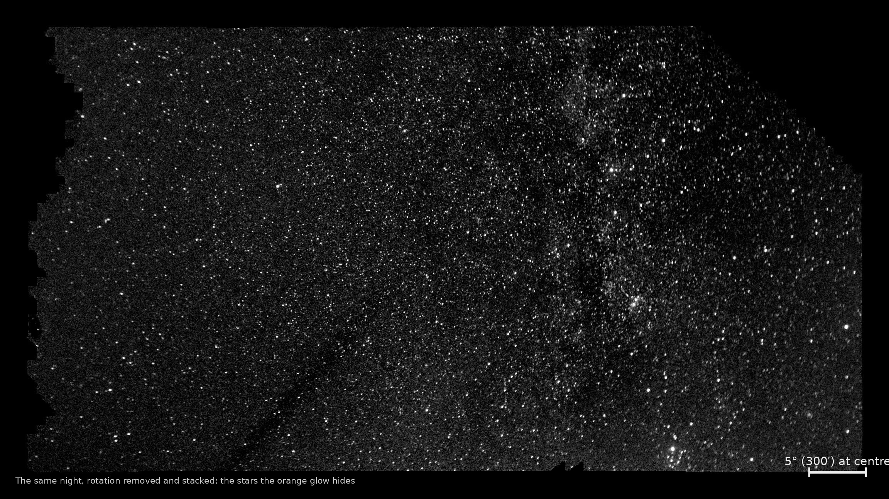

# Too much light pollution for amateur astronomy where you live? Think again!

*And you can do it cheaply, without standing around outside*

*One clear night over a London suburb, 7-8 October 2026: 662 one-minute
frames from a £25 camera, combined into one picture. As the Earth rotates, the stars trace concentric circular arcs, with Polaris near the pole. The dotted lines are aircraft.*

Astrophotography advice starts with "find a dark site". I live in leafy
suburban south-west London; however, Heathrow and the M25/M4 motorways cause
significant light pollution, and local street and house lights add to the
constant sky glow. I also want to DIY as much as I can, and to spend money only where necessary. So back in the spring of 2026 I set out to see what I can see: if I cannot have
a dark sky, I can have a long one. The cameras run every night on their own
while I sleep.

## A live project with daily updates

Over on my website, [www.petergrecian.co.uk/astro](https://www.petergrecian.co.uk/astro?ref=medium), there are automatic updates each morning of the previous night's results. I am really pleased with them. Considering it took two weeks to see my first star, I am blown away by the photo below showing the northern Milky Way: the view out towards the edge of our galaxy, away from its centre. It was made by rotating each image taken that night to undo the rotation of the Earth and adding them all up. It shows the dense band of our galaxy's disc, crossed by dark lanes of dust, some of it made by earlier generations of stars, where new ones may yet form.

*The same night with the sky's rotation removed and the frames stacked: the northern Milky Way runs down the right-hand side.*

*Detail of the Milky Way band from the stack above, enlarged two times.*

## What next

I am in the process of tidying the results: I think the proof-of-concept phase is complete, and I am now consolidating what I have. It has been quite a journey, and there is loads more I could show and explain. I have actually used eight cameras now, and that is quite a story.

Is there something that particularly interests you: the different cameras, the computer kit, the software or the observations? I can prioritise that part of the website.

I am really looking forward to what I am going to see next, and you can join me on the adventure.
