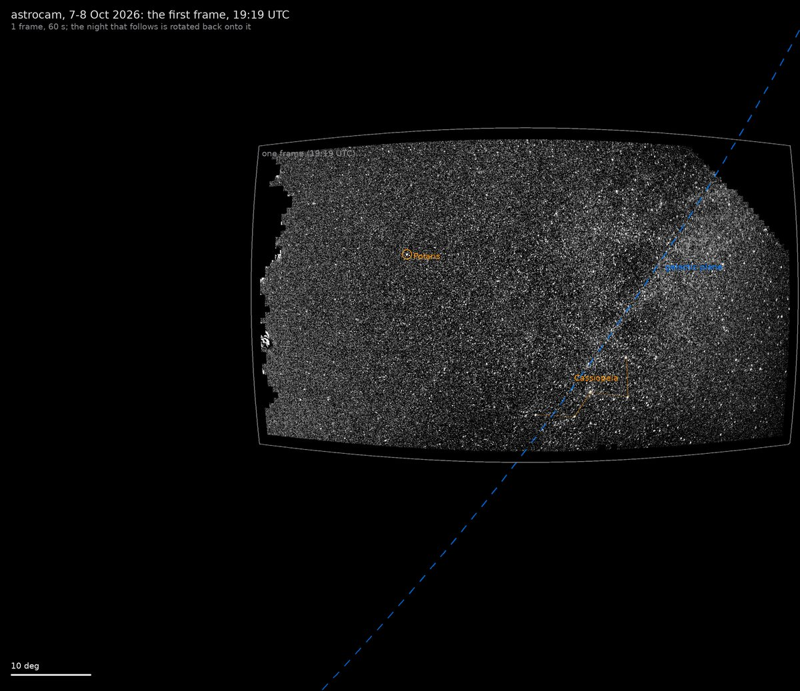
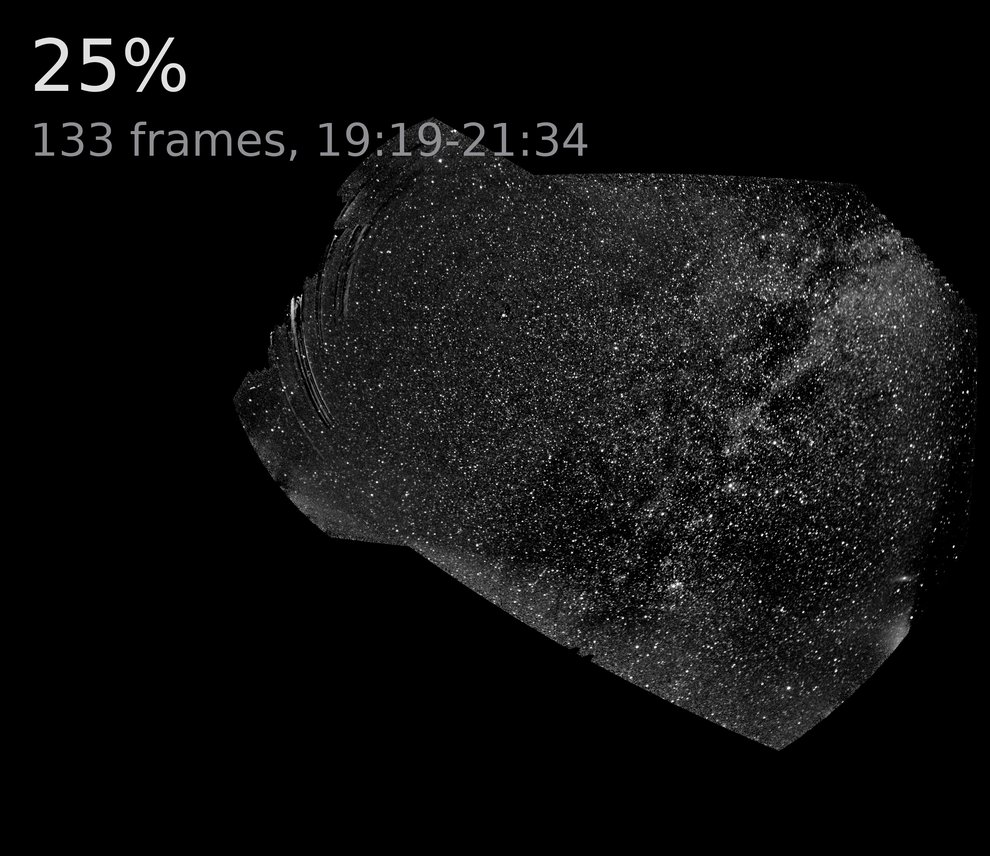
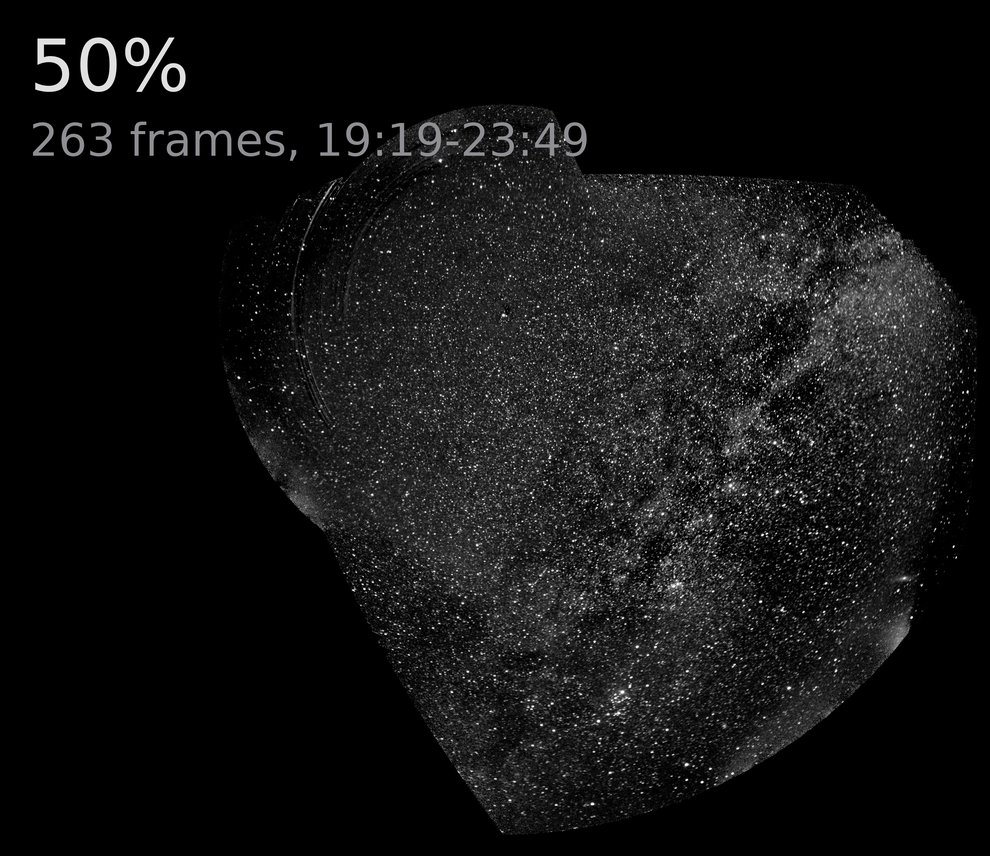
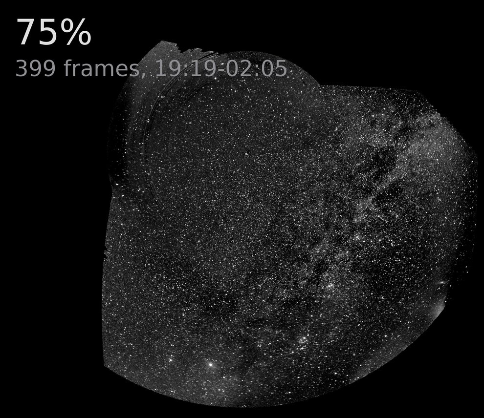
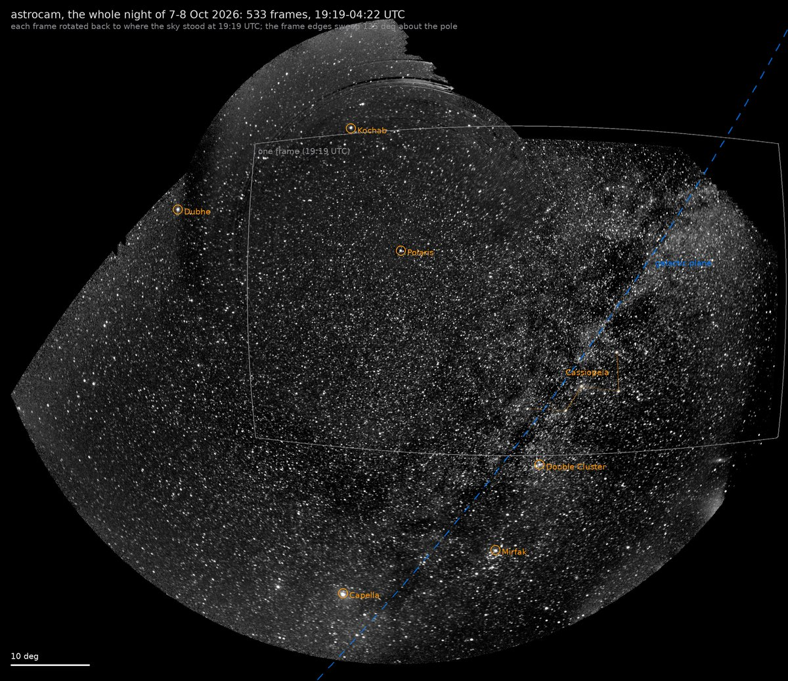
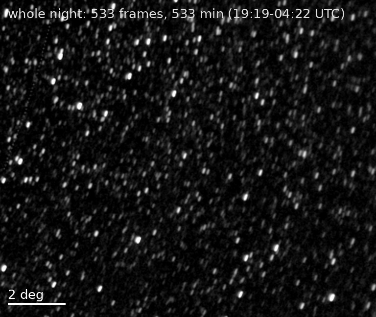
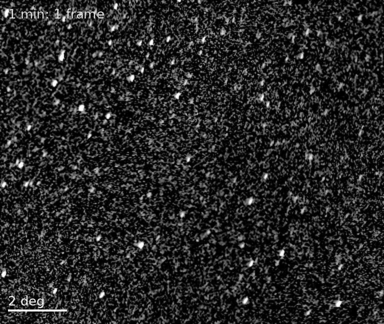
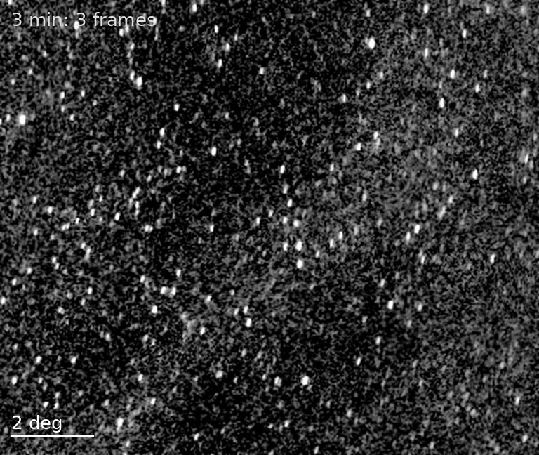
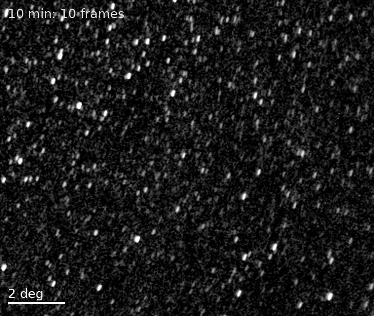
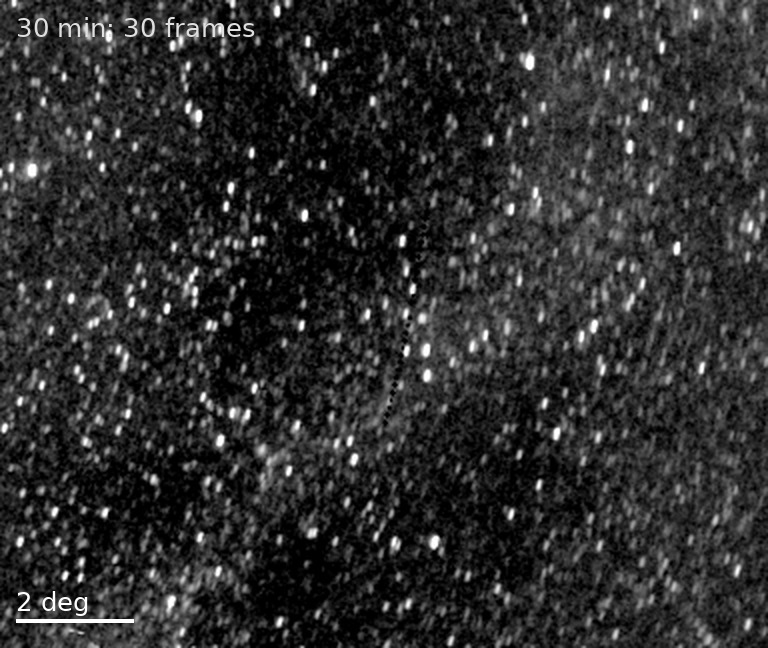

# Too much light pollution for amateur astronomy where you live? Think again!

*You can do it cheaply, without standing around outside*

*One clear night over a London suburb, 7-8 October 2026: 662 one-minute
frames from a £25 camera, combined into one picture. As the Earth rotates, the stars trace concentric circular arcs, with Polaris near the pole. The dotted lines are aircraft. The field of view is about 75 by 42 degrees.*

Astrophotography advice starts with "find a dark site". I live in leafy
suburban south-west London; however, Heathrow and the M25/M4 motorways cause
significant light pollution, and local street and house lights add to the
constant sky glow. I also want to DIY as much as I can, and to spend money only where necessary. So back in the spring of 2026 I set out to see what I can see: if I cannot have
a dark sky, I can have a long one. The cameras run every night on their own
while I sleep.

## A live project with daily updates

Over on my website, [www.petergrecian.co.uk/astro](https://www.petergrecian.co.uk/astro?ref=medium), there are automatic updates each morning of the previous night's results. It took two weeks to see my first star. The photo below shows how far things have come since: the northern Milky Way, the view out towards the edge of our galaxy, away from its centre. It was made by rotating each image taken that night to undo the rotation of the Earth and adding them all up. It shows the dense band of our galaxy's disc, crossed by dark lanes of dust, some of it made by earlier generations of stars, where new ones may yet form.

*One 60-second frame. Even a single minute's exposure shows far more stars than you can see with the naked eye.*

*Then the next 132 frames are added, each one rotated back to the starting position to undo the turning of the Earth: the first quarter of the night, 133 frames.*

*And so on: half the night, 263 frames. The patch of sky the camera covers sweeps round Polaris as the night goes on, and the noise falls.*

*Three quarters of the night, 399 frames.*

*The whole night, 533 frames: almost nine hours of exposure.*

*The whole night with the sky's rotation removed: all 533 dark frames aligned and stacked. The northern Milky Way crosses the frame.*

*Detail of the Milky Way band from the whole night's stack, enlarged two times.*

## From one minute to a whole night

The same patch of sky after 1, 3, 10 and 30 minutes, and after the whole night. Every panel is processed and stretched identically, so only the number of frames changes. As frames add up, the speckle of noise fades and fainter stars appear. Beyond about ten minutes the speckle stops shrinking as fast as you would expect, because what remains is not noise: it is the combined glow of countless stars too faint to pick out singly, which more frames reveal rather than remove.

*The Milky Way close-up at each step. The short dashes are stars moving during each 60-second exposure: the camera is fixed.*

## Results so far

- **18.1 mag/arcsec²**: the brightness of the sky here, measured by comparing what I see with published catalogues.
- **662 one-minute frames** in a single night, captured, stacked and published completely unattended. That is my record so far, and it will grow as the nights get longer.
- **Stars down to magnitude 9.7** in one night's stack, far below what the eye can see from the garden.
- **8 cameras** experimented with so far, from a £25 Pi camera to a Canon DSLR and a tabletop telescope.

## What next

The proof of concept is done, and I am now consolidating what I have. I want to see how far I can take this concept.

A city sky is not a dead end. It just asks for patience and software. Every night's results go up each morning at [www.petergrecian.co.uk/astro](https://www.petergrecian.co.uk/astro?ref=medium).
