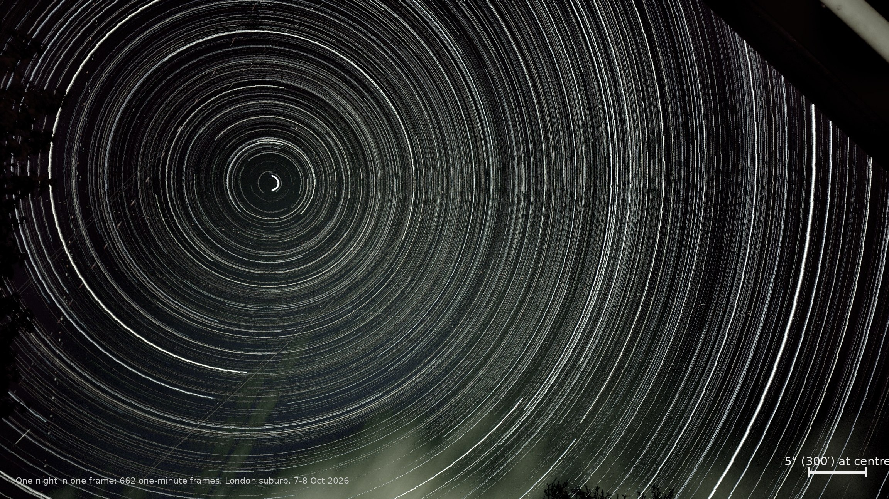

# Too much light pollution for amateur astronomy where you live? Think again!

*And you can do it cheaply, without standing around outside*

*One clear night over a London suburb, 7-8 October 2026: 662 one-minute
frames from a £25 camera, combined into one picture. As the Earth rotates, the stars trace concentric circular arcs, with Polaris near the pole. The dotted lines are aircraft.*

Astrophotography advice starts with "find a dark site". I live in leafy
suburban south-west London; however, Heathrow and the M25/M4 motorways cause
significant light pollution, and local street and house lights add to the
constant sky glow. I also want to DIY as much as I can, and to spend money only where necessary. So back in the spring of 2026 I set out to see what I can see: if I cannot have
a dark sky, I can have a long one. The cameras run every night on their own
while I sleep.

## A live project with daily updates

Over on my website, [www.petergrecian.co.uk/astro](https://www.petergrecian.co.uk/astro?ref=medium), there are automatic updates each morning of the previous night's results. I am really pleased with them. Considering it took two weeks to see my first star, I am blown away by the photo below showing the northern Milky Way: the view out towards the edge of our galaxy, away from its centre. It was made by rotating each image taken that night to undo the rotation of the Earth and adding them all up. It shows the dense band of our galaxy's disc, crossed by dark lanes of dust, some of it made by earlier generations of stars, where new ones may yet form.

*The same night with the sky's rotation removed and the frames stacked: the northern Milky Way runs down the right-hand side.*

*Detail of the Milky Way band from the stack above, enlarged two times.*

## The kit

- Small Pi cameras on Raspberry Pis, in the garden and at a window, aimed
  near the celestial pole
- A home server that stacks each night's frames the next morning
- Photos, stacks and a nightly "how dark was it" chart published on my
  website

## What the sky taught me first

- **Cloud is brighter than twilight here.** Low cloud lit from below by the
  town outshines dusk, so my software was first picking the "darkest" part of
  the night inside the evening twilight. It now looks only after the Sun is
  18 degrees down.
- **The stars turn.** Over a night everything rotates around the pole, so
  frames must be de-rotated before they can be added. Across a month it is
  harder still, because the cameras get nudged and the lens distortion has to
  be modelled.
- **A good night is worth recording.** I keep one clear July night as my
  reference for how dark this sky can get, and every night since is charted
  against it.
- **Hardware has opinions.** A month of frames is about half a terabyte, and
  my stacking server once cut out because its fan had stopped and its CPU
  reached 97 C in seconds.

## Where it stands

A single night's stack already reaches stars around magnitude 9.7 near the
pole, from a garden where you can see perhaps a few dozen by eye. The
month-long stack is next.

Every night's results are public, clear or cloudy:
[www.petergrecian.co.uk/astro](https://www.petergrecian.co.uk/astro?ref=medium)

If you are imaging from a city on a budget, I would love to hear what you are
trying.
